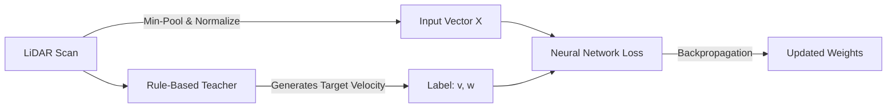

# GUIDEME: Understanding ROS 2, LiDAR, and AI Robot Control

Welcome to the beginner's conceptual guide for the **autonoms_car** project!

If you are comfortable with Python, PyTorch, and deep learning, but new to ROS 2 and robotics integration, this document is written specifically for you. It explains every core concept, mathematical transformation, and design choice in this repository.

---

## 1. How LaserScan Messages Work

In ROS 2, a 2D LiDAR publishes sensor data using the standard `sensor_msgs/msg/LaserScan` message type.

### Message Fields Demystified
When you run `ros2 topic echo /scan --once`, you will see a structure like this:

```yaml
header:
  stamp: {sec: 1729000000, nanosec: 123456789}
  frame_id: "lidar_link"
angle_min: -3.14159265        # Start angle: -pi radians (-180 degrees, behind the car)
angle_max:  3.14159265        # End angle:   +pi radians (+180 degrees, behind the car)
angle_increment: 0.01745329   # Angular step between rays (e.g. 2*pi / 360 = ~1 degree)
range_min: 0.10               # Minimum distance the sensor can physically measure (meters)
range_max: 20.00              # Maximum range limit of the laser emitter (meters)
ranges: [3.4, 3.5, inf, ...]  # Array of distance measurements in meters
```

### The Angle Formula
Each reading in `ranges[i]` corresponds to an exact geometric ray angle:
$$\theta_i = \text{angle\_min} + i \times \text{angle\_increment}$$

In standard ROS conventions:
- $\theta = 0\,\text{rad}$ is **straight ahead** (index $180$ in a 360-ray scan).
- $\theta > 0\,\text{rad}$ is to the **left** of the vehicle (counter-clockwise).
- $\theta < 0\,\text{rad}$ is to the **right** of the vehicle (clockwise).

### The `inf` and `nan` Trap
Unlike camera images which always contain valid pixel numbers:
- An obstacle beyond the sensor range returns `float('inf')`. In obstacle avoidance, `inf` does **not** mean an error — it means **free, unobstructed space**!
- A specular reflection, glass surface, or measurement error can return `float('nan')`.
- In `LidarPreprocessor` ([preprocessor.py](file:///c:/Users/dhana/OneDrive/Desktop/Learning/projects/Robotics%20with%20AI/autonoms_car/autonoms_car/preprocessor.py)), we automatically convert `inf` to `range_max` (safe space) and `nan` to `range_min` (conservative safety).

---

## 2. Transforming Scans into Neural Network Inputs

### Why Can't We Just Feed All 360 Rays into the Network?
1. **Sensor Dependency:** If you switch from a 360-ray LiDAR to a 720-ray or 1080-ray LiDAR, your neural network input dimension would break!
2. **Overfitting to Noise:** Ray-level noise can cause the MLP to memorize individual ray indices rather than understanding regional spatial clearance.

### The Solution: Sector Min-Pooling
We partition the $360^\circ$ circle into **36 angular sectors** (each sector spans $10^\circ$).

Within each sector, we compute the **minimum distance**:
$$\text{sector\_dist}_k = \min_{j \in \text{sector}_k} (\text{ranges}[j])$$

> [!IMPORTANT]
> **Why Min-Pooling instead of Average-Pooling?**
> If a narrow obstacle (like a pole or chair leg) occupies just one ray in a sector while nine other rays hit a wall 10 meters away, an **average** would produce $\approx 9\,\text{m}$, hiding the pole! **Min-pooling** guarantees the closest hazard is preserved.

### Feature Normalization
Neural networks perform best when input values are bounded between $0.0$ and $1.0$:
$$x_k = \text{clip}\left(\frac{\text{sector\_dist}_k - r_{min}}{r_{max} - r_{min}}, 0.0, 1.0\right)$$
- $x_k = 0.0$: Obstacle is at or below $r_{min}$ (danger!).
- $x_k = 1.0$: Sector is completely open up to $r_{max}$.

---

## 3. How Supervised Imitation Learning Works Here

In reinforcement learning (like PPO), a robot explores randomly for hours, crashes thousands of times, and requires complex reward tuning.

In this experiment, we use **Behavioral Cloning (Supervised Learning)**:



1. **The Teacher:** The `RuleBasedTeacher` ([rule_based_teacher.py](file:///c:/Users/dhana/OneDrive/Desktop/Learning/projects/Robotics%20with%20AI/autonoms_car/autonoms_car/rule_based_teacher.py)) uses simple, clear rules:
   - When front distance $> 1.2\,\text{m} \implies$ drive forward.
   - When front distance $< 1.2\,\text{m} \implies$ slow down and steer toward the side with more room.
   - When front distance $< 0.35\,\text{m} \implies$ stop linear motion and spin in place.
2. **The Collector:** The `DatasetCollector` records pairs of `(normalized_scan_vector, teacher_v_and_w)`.
3. **The Neural Network:** The MLP acts as a smooth continuous function approximator mapping the 36-dimensional clearance vector directly to velocity commands.

---

## 4. How `cmd_vel` Controls a Differential-Drive Toy Car

A differential-drive robot has two driven wheels (left and right) on a shared axis:

```
      [ Left Wheel ]  (speed v_L)
            |
            |--- Track Width L ---|
            |
      [ Right Wheel ] (speed v_R)
```

The ROS 2 controller publishes a `geometry_msgs/msg/Twist` message on the `/cmd_vel` topic:
- `linear.x` ($v$ in $\text{m/s}$): Forward velocity along the vehicle's body axis.
- `angular.z` ($\omega$ in $\text{rad/s}$): Rotational velocity around the vertical axis.

### Inside the Isaac Sim Differential Controller:
Isaac Sim's differential controller node converts $(v, \omega)$ into individual wheel joint rotational velocities $(\dot{\theta}_L, \dot{\theta}_R)$:
$$v_R = v + \frac{\omega \cdot L}{2}, \quad v_L = v - \frac{\omega \cdot L}{2}$$
$$\dot{\theta}_R = \frac{v_R}{R_{wheel}}, \quad \dot{\theta}_L = \frac{v_L}{R_{wheel}}$$

- **Pure Forward Motion:** $\omega = 0 \implies v_L = v_R$.
- **Turning Left:** $\omega > 0 \implies v_R > v_L$ (right wheel spins faster).
- **Turning Right:** $\omega < 0 \implies v_L > v_R$ (left wheel spins faster).
- **In-Place Rotation (Emergency Spin):** $v = 0, \omega \neq 0 \implies v_R = -v_L$ (wheels rotate in opposite directions).

---

## 5. Neural Network Design & Activation Functions

In [model.py](file:///c:/Users/dhana/OneDrive/Desktop/Learning/projects/Robotics%20with%20AI/autonoms_car/autonoms_car/model.py):

```python
# Linear velocity head: strictly forward in [0, max_linear_vel]
v = torch.sigmoid(raw_outputs[:, 0:1]) * self.max_linear_vel

# Angular velocity head: symmetric steering in [-max_angular_vel, +max_angular_vel]
w = torch.tanh(raw_outputs[:, 1:2]) * self.max_angular_vel
```

- **Why Sigmoid for $v$?**
  Sigmoid maps outputs smoothly to $(0, 1)$. Multiplying by `max_linear_vel` guarantees the vehicle never commands backward speeds accidentally during forward obstacle avoidance.
- **Why Tanh for $\omega$?**
  Tanh maps outputs symmetrically to $(-1, 1)$. Multiplying by `max_angular_vel` gives equal steering authority to both left and right directions, with $0.0$ representing straight driving.

---

## 6. Real-Time Safety & Watchdog Architecture

Deep neural networks can occasionally produce unexpected outputs when presented with out-of-distribution sensor patterns. In robotics, an AI model is never allowed to control actuators without a deterministic safety envelope:

1. **Sensor Timeout Watchdog:**
   If Isaac Sim freezes or the network drops, `watchdog_callback` checks the elapsed time since the last valid scan. If $\Delta t > 0.35\,\text{s}$, it forces $v=0, \omega=0$.
2. **Emergency Shield Reflex:**
   Even if the neural network predicts high forward speed, the preprocessor measures the physical minimum distance in the forward zone. If an obstacle is detected closer than $0.30\,\text{m}$, the node overrides the neural network and slams the brakes:
   ```python
   if front_d <= self.emergency_stop_dist:
       pred_v = 0.0
       pred_w = max_turn_away_from_closest_obstacle
   ```

---

## 7. How to Debug the Pipeline in ROS 2

### Diagnostic Cheat Sheet

| Goal | Command | What to Look For |
| :--- | :--- | :--- |
| **List active topics** | `ros2 topic list` | Verify `/scan` and `/cmd_vel` appear. |
| **Check sensor rate** | `ros2 topic hz /scan` | Should report $\approx 10\,\text{Hz}$ to $20\,\text{Hz}$. |
| **Inspect raw scan** | `ros2 topic echo /scan --once` | Confirm ranges array contains non-zero floats. |
| **Monitor AI output** | `ros2 topic echo /cmd_vel` | Check `linear.x` and `angular.z` change smoothly. |
| **View node graph** | `rqt_graph` | Displays visual arrows connecting Isaac Sim and AI node. |

You are now ready to run and test the complete pipeline!
