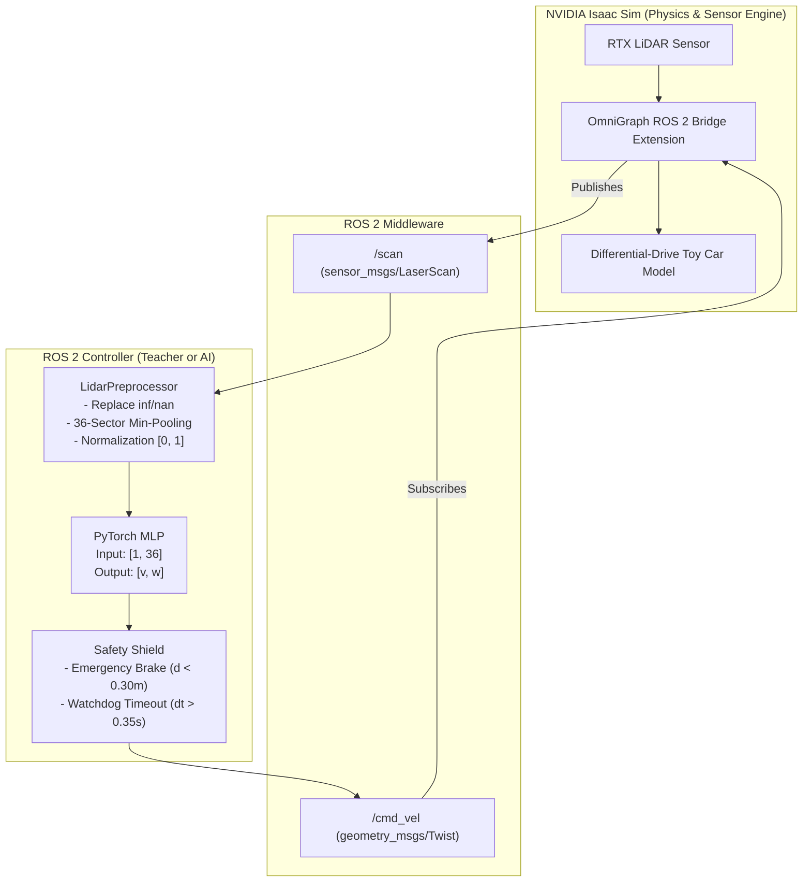

# autonoms_car: ROS 2 + Isaac Sim AI Obstacle Avoidance

An educational robotics and deep learning repository demonstrating how an Artificial Neural Network (MLP) controls a differential-drive toy car in NVIDIA Isaac Sim via ROS 2.

---

## 1. Project Purpose

This project is an end-to-end learning experiment designed to master:
- **ROS 2 Communication:** Exchanging sensor telemetry and motor actuation between Isaac Sim and Python nodes.
- **LiDAR Sensor Processing:** Cleaning, sector min-pooling, and normalizing 2D `LaserScan` measurements.
- **Supervised Imitation Learning:** Training a compact PyTorch Multi-Layer Perceptron (MLP) on expert obstacle-avoidance demonstrations.
- **AI Control & Safety:** Running neural network inference in real-time with an active safety watchdog and emergency braking shield.

---

## 2. System Architecture

The architecture is strictly decoupled. NVIDIA Isaac Sim simulates the physical world and sensors, while ROS 2 standard topics bridge communication to external Python nodes.



---

## 3. Repository Structure

```
autonoms_car/
├── package.xml                       # ROS 2 package manifest
├── setup.py                          # Build and script entry point definitions
├── setup.cfg                         # ROS 2 build configuration
├── README.md                         # Comprehensive project documentation
├── GUIDEME.md                        # Beginner-friendly conceptual and debugging guide
├── config/
│   └── params.yaml                   # Centralized parameters, topics, and thresholds
├── launch/
│   ├── teacher.launch.py             # Launches rule-based controller
│   ├── ai_controller.launch.py       # Launches trained AI neural network controller
│   └── mock_simulation.launch.py     # Launches mock LiDAR + AI controller offline
├── autonoms_car/
│   ├── __init__.py
│   ├── preprocessor.py               # LidarPreprocessor: min-pooling & normalization
│   ├── model.py                      # ObstacleAvoidanceMLP PyTorch architecture
│   ├── rule_based_teacher.py         # Baseline & expert supervisor node
│   ├── dataset_collector.py          # Synchronized scan + cmd_vel recorder (.npz)
│   ├── train.py                      # PyTorch training script with synthetic fallback
│   ├── ai_controller_node.py         # Real-time ROS 2 inference node with safety shield
│   └── mock_lidar_node.py            # Standalone simulated LiDAR publisher
├── test/
│   └── test_pipeline.py              # Automated unit tests for preprocessor & model
├── models/
│   └── obstacle_avoidance_mlp.pth    # Saved PyTorch model checkpoint
└── dataset/
    └── training_data.npz             # Recorded sensor-action dataset
```

---

## 4. Dependencies & Prerequisites

### System Requirements
- **OS:** Ubuntu 24.04 LTS (or Ubuntu 22.04 LTS).
- **ROS 2:** Humble Hawksbill or Jazzy Jalisco.
- **Python:** Python 3.10, 3.11, or 3.12.
- **Simulator:** NVIDIA Isaac Sim (v4.0+ recommended) with ROS 2 Bridge enabled.

### Python Packages
```bash
pip install torch numpy
```

---

## 5. Build and Installation

Clone or place this repository inside your ROS 2 workspace (e.g., `~/ros2_ws/src/autonoms_car`):

```bash
# 1. Navigate to your workspace root
cd ~/ros2_ws

# 2. Source your ROS 2 environment
source /opt/ros/$ROS_DISTRO/setup.bash

# 3. Build the package
colcon build --packages-select autonoms_car

# 4. Source your workspace overlay
source install/setup.bash
```

---

## 6. Complete Workflow Step-by-Step

### Phase 1: Test Offline (No Isaac Sim Needed)
You can verify the entire pipeline immediately on any workstation:

```bash
# Step 1: Run unit tests
python3 -m unittest discover -s test

# Step 2: Generate synthetic baseline data and train the neural network
python3 -m autonoms_car.train --epochs 30

# Step 3: Launch mock simulation to see the AI controller steer away from mock obstacles
ros2 launch autonoms_car mock_simulation.launch.py
```

---

### Phase 2: Isaac Sim OmniGraph Setup (For Teammate)

To connect Isaac Sim to ROS 2, verify these OmniGraph nodes in the car's Action Graph:

1. **LiDAR Publisher Graph:**
   - `Isaac Read LiDAR Beam Node` (targets the LiDAR prim).
   - `ROS 2 Context` (`domain_id: 0`).
   - `ROS 2 Publish LaserScan` (topic name: `/scan`, frame id: `lidar_link`).

2. **Wheel Velocity Subscriber Graph:**
   - `ROS 2 Subscribe Twist` (topic name: `/cmd_vel`).
   - `Break 3-Vector` (extracts `linear.x` and `angular.z`).
   - `Differential Controller` node (inputs: linear velocity, angular velocity; outputs: left and right wheel joint angular speeds).
   - `Articulation Controller` (targets the car articulation root, driving left and right wheel joints).

---

### Phase 3: Live Verification in Isaac Sim

#### 1. Sanity Check Sensor Telemetry
With Isaac Sim playing, open a terminal:
```bash
# Check that scan messages are publishing
ros2 topic hz /scan
ros2 topic echo /scan --once
```

#### 2. Sanity Check Vehicle Actuation
Publish a manual forward-steering pulse:
```bash
ros2 topic pub --once /cmd_vel geometry_msgs/msg/Twist "{linear: {x: 0.25}, angular: {z: 0.5}}"
```
Verify the toy car steers forward and to the left.

---

### Phase 4: Data Collection with the Teacher

1. **Run the Rule-Based Teacher:**
   ```bash
   ros2 launch autonoms_car teacher.launch.py
   ```
   Observe the car cruising around obstacles in Isaac Sim.

2. **In a second terminal, start the Dataset Collector:**
   ```bash
   ros2 run autonoms_car dataset_collector --ros-args -p target_samples:=4000
   ```
   Allow the car to record 4,000 samples (~5–7 minutes of driving). The node will automatically save `dataset/training_data.npz` and stop.

---

### Phase 5: Train the PyTorch Neural Network

```bash
python3 -m autonoms_car.train --data dataset/training_data.npz --output models/obstacle_avoidance_mlp.pth --epochs 35
```
Watch the loss table: validation loss will drop from $\sim 0.35$ down to $< 0.02$. The best model weights will be saved to `models/obstacle_avoidance_mlp.pth`.

---

### Phase 6: Run the AI Controller in Isaac Sim

Stop the teacher node and launch the trained neural network controller:
```bash
ros2 launch autonoms_car ai_controller.launch.py
```

The car is now driven directly by neural network predictions!

---

## 7. Safety Features

1. **Emergency Shield (Hard Collision Override):**
   If an obstacle enters the vehicle's critical forward boundary ($d < 0.30\,\text{m}$), forward speed is cut to $0.0\,\text{m/s}$ and maximum rotational velocity is applied away from the obstacle.
2. **Sensor Watchdog:**
   If `LaserScan` updates cease for $> 0.35\,\text{s}$ (e.g. simulator paused or network glitch), the controller automatically publishes zero velocities to prevent runaway motion.
3. **Velocity Clamping:**
   Strict saturation limits ($v_{max} = 0.35\,\text{m/s}$, $\omega_{max} = 1.20\,\text{rad/s}$) prevent motor strain and simulation explosions.

---

## 8. Troubleshooting

| Issue | Cause | Solution |
| :--- | :--- | :--- |
| `[Watchdog] Sensor data stale` | `/scan` not publishing or topic name mismatch | Run `ros2 topic list`. Verify OmniGraph in Isaac Sim is set to `/scan`. Check `ROS_DOMAIN_ID`. |
| Car doesn't move on `/cmd_vel` | OmniGraph Differential Controller not linked to joint drives | Check wheel joint names and drive gains (stiffness=0, damping>0 for velocity control) in Isaac Sim. |
| Model turns in circles | Unbalanced dataset or reversed steering sign | Ensure dataset contains both left and right turns. Check whether positive angular velocity turns left or right in your model. |
| Model file not found | Training script has not been run | Execute `python3 -m autonoms_car.train` to generate `models/obstacle_avoidance_mlp.pth`. |
