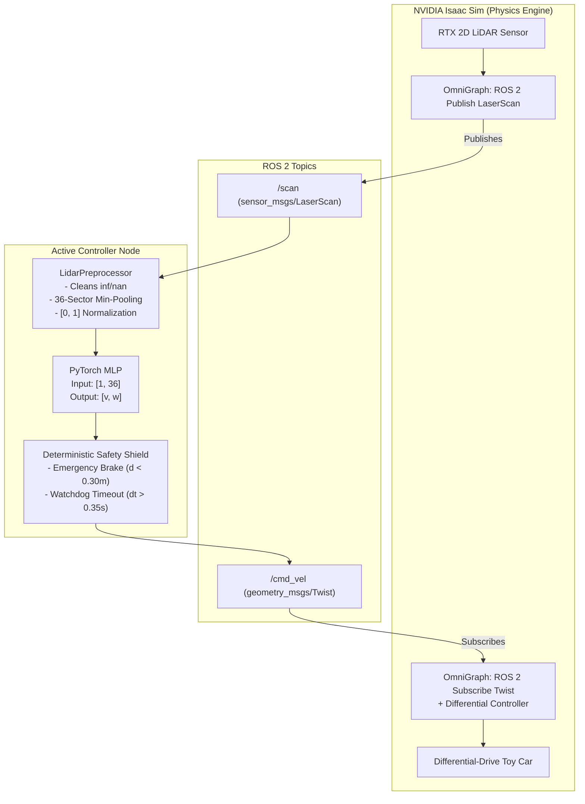
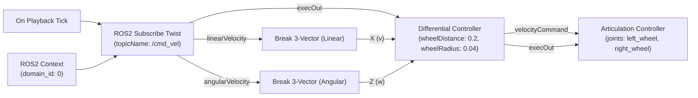
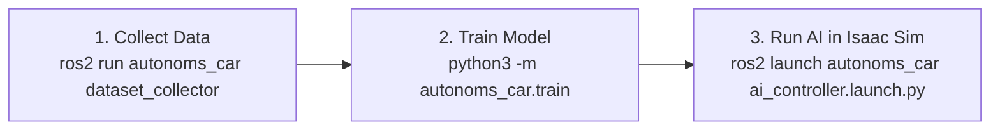

# Complete 0 to 100 Guide: `autonoms_car`
### End-to-End AI Obstacle Avoidance for a Differential-Drive Toy Car in NVIDIA Isaac Sim via ROS 2

---

## 📖 Table of Contents
1. [System Architecture](#1-system-architecture)
2. [Prerequisites & System Setup](#2-prerequisites--system-setup)
3. [Workspace Setup & Build](#3-workspace-setup--build)
4. [Python Environment Setup (`.venv`)](#4-python-environment-setup-venv)
5. [The ROS 2 Shebang Trap & Fix](#5-the-ros-2-shebang-trap--fix)
6. [Isaac Sim Configuration (Physics & OmniGraph)](#6-isaac-sim-configuration-physics--omnigraph)
7. [The 3 Core Pipeline Commands](#7-the-3-core-pipeline-commands)
8. [Deterministic Safety Architecture](#8-deterministic-safety-architecture)
9. [Master Troubleshooting & Cheat Sheet](#9-master-troubleshooting--cheat-sheet)
10. [Next Milestone: Goal-Conditioned Navigation](#10-next-milestone-goal-conditioned-navigation)

---

## 1. System Architecture

The project connects simulation physics, ROS 2 messaging middleware, and neural network inference:



---

## 2. Prerequisites & System Setup

- **Operating System:** Ubuntu 22.04 LTS (Jammy) or Ubuntu 24.04 LTS (Noble) / WSL2.
- **ROS 2:** Humble Hawksbill or Jazzy Jalisco (`desktop` install recommended).
- **Simulator:** NVIDIA Isaac Sim (v4.0+) with `omni.isaac.ros2_bridge` enabled.
- **Python:** Python 3.10, 3.11, or 3.12.
- **Hardware:** NVIDIA RTX GPU (RTX 3060 or higher recommended for Isaac Sim).

---

## 3. Workspace Setup & Build

Clone or place this repository inside your ROS 2 workspace (e.g. `~/ai_diff_robot/src/autonoms_car`):

```bash
# 1. Navigate to your ROS 2 workspace root
cd ~/ai_diff_robot

# 2. Source your system ROS 2 distribution
source /opt/ros/$ROS_DISTRO/setup.bash

# 3. Build the package
colcon build --symlink-install --packages-select autonoms_car

# 4. Source the built workspace overlay
source install/setup.bash
```

---

## 4. Python Environment Setup (`.venv`)

> [!IMPORTANT]
> **The `--system-site-packages` Rule:**
> In ROS 2, libraries like `rclpy`, `sensor_msgs`, and `geometry_msgs` are installed at the system level (`/opt/ros/...`). An isolated virtual environment cannot see them. Creating the venv with `--system-site-packages` bridges system ROS 2 and pip-installed PyTorch together seamlessly.

### Step-by-Step Installation:

```bash
# 1. Create the virtual environment with access to system packages
cd ~/ai_diff_robot
python3 -m venv --system-site-packages .venv

# 2. Activate the virtual environment
source .venv/bin/activate
# (Your prompt will now show `(.venv)`)

# 3. Upgrade pip
pip install --upgrade pip

# 4. Install dependencies:
# If you have an NVIDIA GPU (recommended):
pip install torch --index-url https://download.pytorch.org/whl/cu121
pip install -r src/autonoms_car/requirements.txt

# OR if running CPU only:
pip install -r src/autonoms_car/requirements.txt

# 5. Verify the entire stack in one command:
python3 -c "import rclpy, torch, numpy; print(f'Ready! PyTorch {torch.__version__} | CUDA: {torch.cuda.is_available()} | ROS 2 rclpy OK')"
```

---

## 5. The ROS 2 Shebang Trap & Fix

### The Problem
When you run `colcon build`, ROS 2 generates executable script wrappers under `install/autonoms_car/lib/autonoms_car/`. 
By default, `colcon` hardcodes the system Python path in the very first line (**Shebang**):
```bash
#!/usr/bin/python3
```
Because PyTorch was installed inside your `.venv`, running `ros2 launch` caused Linux to execute `/usr/bin/python3`, triggering:
`ModuleNotFoundError: No module named 'torch'`.

### The Solution: Environment Shebang (`#!/usr/bin/env python3`)
Replace the hardcoded path with `#!/usr/bin/env python3`. This instructs Linux to dynamically execute whichever Python environment is currently active in your terminal:

```bash
# Run this once after colcon build:
sed -i '1s|.*|#!/usr/bin/env python3|' ~/ai_diff_robot/install/autonoms_car/lib/autonoms_car/ai_controller
sed -i '1s|.*|#!/usr/bin/env python3|' ~/ai_diff_robot/install/autonoms_car/lib/autonoms_car/rule_based_teacher
sed -i '1s|.*|#!/usr/bin/env python3|' ~/ai_diff_robot/install/autonoms_car/lib/autonoms_car/dataset_collector

# Source the workspace overlay
source install/setup.bash
```

---

## 6. Isaac Sim Configuration (Physics & OmniGraph)

### Part A: Wheel Joint Physics (Crucial for Differential Drive)
In Isaac Sim, select your car in the **Stage tree** and find the two wheel revolute joints (`left_wheel_joint`, `right_wheel_joint`):
1. In the **Property Panel** on the right, find **Drive** (or Angular Drive):
   - **Type:** `Velocity` (or `Angular`).
   - **Stiffness:** **`0.0`** *(Must be 0. If > 0, the wheel acts like a spring and resists spinning).*
   - **Damping:** **`1000.0`** (or `5000.0`). Damping provides the motor torque.
   - **Max Force:** **`1000.0`** or higher.

---

### Part B: The ROS 2 `/cmd_vel` Action Graph
Open your Action Graph (**Window $\rightarrow$ Visual Scripting $\rightarrow$ Action Graph**):



#### Node Properties & Connections:
1. **`ROS2 Context`**: Leave default (`domain_id: 0`).
2. **`ROS2 Subscribe Twist`**:
   - Connect `context` $\rightarrow$ `ROS2 Context.context`.
   - Connect `execIn` $\rightarrow$ `On Playback Tick.tick`.
   - In Properties, set **`topicName`** to `/cmd_vel`.
3. **`Break 3-Vector` (Box A - Linear):**
   - Connect `tuple` $\leftarrow$ `ROS2 Subscribe Twist.linearVelocity`.
   - Connect `X` $\rightarrow$ `Differential Controller.linearVelocity`.
4. **`Break 3-Vector` (Box B - Angular):**
   - Connect `tuple` $\leftarrow$ `ROS2 Subscribe Twist.angularVelocity`.
   - Connect `Z` $\rightarrow$ `Differential Controller.angularVelocity`.
5. **`Differential Controller`**:
   - Connect `execIn` $\leftarrow$ `ROS2 Subscribe Twist.execOut`.
   - In Properties, set your vehicle dimensions: `wheelDistance` (e.g. `0.2`) and `wheelRadius` (e.g. `0.04`).
6. **`Articulation Controller`**:
   - Connect `execIn` $\leftarrow$ `Differential Controller.execOut`.
   - Connect `velocityCommand` $\leftarrow$ `Differential Controller.velocityCommand`.
   - In Properties: `targetPrim` = your car root (e.g. `/World/toy_car`), and `jointNames` = `["left_wheel_joint", "right_wheel_joint"]`.

---

### Part C: The 2-Second Sanity Verification
With Isaac Sim playing, open a terminal on your PC:
```bash
ros2 topic pub --once /cmd_vel geometry_msgs/msg/Twist "{linear: {x: 0.3}, angular: {z: 0.5}}"
```
**If the toy car rolls forward and steers left, your bridge is 100% verified!**

---

## 7. The 3 Core Pipeline Commands

Once your bridge is verified, execute these 3 steps to run the complete AI pipeline:



### Command 1: Collect Data from Isaac Sim
1. In Isaac Sim, press **Play**.
2. In **Terminal 1**, run the rule-based teacher so the car drives autonomously and explores:
   ```bash
   ros2 launch autonoms_car teacher.launch.py
   ```
3. In **Terminal 2** (with `.venv` active), record sensor-action pairs:
   ```bash
   ros2 run autonoms_car dataset_collector
   ```
- It automatically logs synchronized pairs of `(36-sector scan, linear_v & angular_w)`.
- When 4,000 samples are logged (~5 minutes), it saves `dataset/training_data.npz` and exits.
- Press `Ctrl + C` in Terminal 1.

---

### Command 2: Train the PyTorch Neural Network
In your terminal (with `.venv` active), run:
```bash
cd ~/ai_diff_robot
python3 -m autonoms_car.train --data dataset/training_data.npz --output models/obstacle_avoidance_mlp.pth --epochs 35
```
*(Alternative ROS 2 command: `ros2 run autonoms_car train_mlp`)*

- Uses an asymmetric weighted loss function: $\mathcal{L} = \text{MSE}(v) + 2.0 \times \text{MSE}(\omega)$ to prioritize collision avoidance.
- Evaluates validation loss on an 80/20 split and saves the best model checkpoint to `models/obstacle_avoidance_mlp.pth`.

---

### Command 3: Run the AI Controller in Isaac Sim
Keep Isaac Sim running in **Play** mode, then launch the trained AI controller:
```bash
ros2 launch autonoms_car ai_controller.launch.py
```
- The car is now steered directly by neural network inference!
- Real-time safety shields actively monitor for emergency braking conditions.

---

## 8. Deterministic Safety Architecture

A neural network should never directly command actuators without safety constraints. The AI controller includes:

1. **Emergency Shield Reflex ($d_{front} \le 0.30\,\text{m}$):**
   If an obstacle enters the critical threshold, the neural network prediction is overridden immediately: forward velocity is forced to $0.0\,\text{m/s}$, and maximum steering away from the closest wall is applied.
2. **Sensor Watchdog ($\Delta t > 0.35\,\text{s}$):**
   If `/scan` telemetry pauses (simulator freeze, networking drop), a 20 Hz watchdog timer halts the vehicle by publishing zero velocities to prevent runaway collisions.
3. **Hardware Velocity Clamping:**
   Strict saturation limits ($v \in [0.0, 0.35]\,\text{m/s}$, $\omega \in [-1.20, +1.20]\,\text{rad/s}$) prevent motor strain and simulation explosions.

---

## 9. Master Troubleshooting & Cheat Sheet

| Symptom / Error | Root Cause | Solution |
| :--- | :--- | :--- |
| `ModuleNotFoundError: No module named 'torch'` | The executable shebang in `install/` is pointing to `/usr/bin/python3`. | Run `sed -i '1s|.*|#!/usr/bin/env python3|' ~/ai_diff_robot/install/autonoms_car/lib/autonoms_car/ai_controller`. |
| `ModuleNotFoundError: No module named 'rclpy'` | Virtual environment was created without system packages. | Recreate venv with: `python3 -m venv --system-site-packages .venv`. |
| Car doesn't move on `/cmd_vel` | Wheel joint stiffness $> 0$ or damping is 0. | In Isaac Sim Joint Properties: Set **Stiffness = 0.0**, **Damping = 1000.0**, **Type = Velocity**. |
| `[Watchdog] Sensor data stale` | Isaac Sim is paused or `/scan` topic is mismatched. | Ensure simulation is playing; run `ros2 topic list` and check `ROS_DOMAIN_ID=0`. |
| `can't open file 'autonomos_car.train'` | Typo in package name or missing `-m` flag. | Correct command: `python3 -m autonoms_car.train` (spelled `autonoms_car`). |

---

## 10. Next Milestone: Goal-Conditioned Navigation

Currently, the car performs **reactive wander & obstacle avoidance** (like a Roomba). 

To turn this into a true self-driving delivery vehicle, the next upgrade is **Goal-Conditioned Navigation**:
1. **Target Beacon:** Spawn a goal marker at coordinate $(X_g, Y_g)$ in Isaac Sim.
2. **Relative Goal Vector:** Calculate distance to goal $d_{goal}$ and heading angle error $\theta_{goal}$.
3. **Upgraded Input Vector:** Feed $[36\text{ LiDAR distances}] + [d_{goal}, \theta_{goal}]$ (38 inputs) into the neural network.
4. **Behavior:** The vehicle tracks and drives directly to destination waypoints while dynamically navigating around static and moving obstacles!
